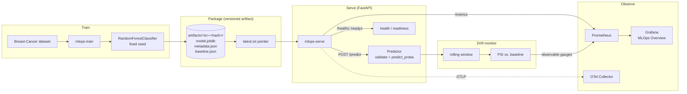

# MLOpsPipelineDemo

A minimal but **complete** MLOps loop you can run end-to-end on a laptop:
**train** a classifier, **package** it as an immutable versioned artifact, **serve**
it behind a FastAPI REST API with health/readiness checks and structured JSON
logging, **observe** it with OpenTelemetry → Prometheus → Grafana, and
**monitor drift** with the Population Stability Index (PSI).

The project is intentionally small in scope but faithful to production practice:
reproducible artifacts, a pull-based metrics path, provisioned-as-code dashboards,
a non-root container, and a lint/type-check/test/build CI pipeline.

- **Dataset:** scikit-learn Breast-Cancer (Wisconsin) — binary, 30 continuous features.
- **Model:** `RandomForestClassifier` (fixed seed, `predict_proba` enabled).
- **Transport:** REST only.
- **Drift measure:** PSI (per-feature + aggregate).

Design and requirements references:
[SRS](docs/requirements/SRS.md) ·
[DESIGN](docs/design/DESIGN.md) ·
[CI/CD & observability pipeline](docs/ci-cd/mlops-pipeline-demo-pipeline.md).

## What this demonstrates

- **Model packaging & versioning** — every training run writes an immutable
  `artifacts/<UTC-timestamp>-<short-content-hash>/` directory (`model.joblib` +
  `metadata.json` + `baseline.json`) with a `latest.txt` pointer.
- **Contract-first serving** — Pydantic v2 request validation, HTTP 422 on bad
  input, a response that carries the exact `model_version` that produced it.
- **Operational readiness** — liveness/readiness split; the service is *not ready*
  until a valid artifact is loaded.
- **Observability by construction** — an inference-latency histogram, request/error
  counters, a predicted-class counter, and observable gauges for model readiness,
  model info, and PSI drift — all under the `mlops_` prefix, all wired into a
  provisioned Grafana dashboard.
- **Reproducibility** — pinned dependencies (`constraints.txt`), a clean-checkout
  container build, and CI that runs the same checks locally and in GitHub Actions.

## Architecture



## Quickstart — local development

Requires Python 3.11+.

```bash
python -m venv .venv && source .venv/bin/activate
pip install -e ".[dev]"
```

Train a model (writes `artifacts/<version-id>/` and updates `latest.txt`):

```bash
mlops-train
# → Wrote artifact 20260919T120000Z-ab12cd34 → artifacts/20260919T120000Z-ab12cd34
# → Metrics: {'accuracy': ..., 'f1': ..., 'precision': ..., 'recall': ...}
```

Serve the latest artifact (launches uvicorn on `http://localhost:8000`):

```bash
mlops-serve
```

Send a prediction and view metrics:

```bash
curl -s http://localhost:8000/readyz

curl -s -X POST http://localhost:8000/predict \
  -H 'content-type: application/json' \
  -d '{"features": {"mean radius": 14.1, "mean texture": 20.2, "...": 0.0}}'
  # all 30 named features are required

curl -s http://localhost:8000/metrics | grep '^mlops_'
```

Interactive OpenAPI docs are available at `http://localhost:8000/docs`.

### Useful `mlops-train` flags

| Flag | Default | Purpose |
| --- | --- | --- |
| `--seed` | `42` | Training seed (reproducibility). |
| `--n-estimators` | `200` | Random-forest size. |
| `--n-bins` | `10` | PSI baseline histogram bins. |
| `--test-size` | `0.2` | Hold-out fraction. |
| `--artifacts-dir` | `artifacts` | Artifact store root. |

## Quickstart — Docker Compose

Brings up the whole loop (service + OTel Collector + Prometheus + Grafana) with a
single command and no manual post-setup:

```bash
docker compose up --build      # start the stack
docker compose down            # stop
docker compose down -v         # stop and wipe the trained-model volume
```

**How the container gets an artifact:** the image bakes *no* model. On first start,
`docker-entrypoint.sh` runs `mlops-train` into the `mlops-artifacts` named volume
only when `latest.txt` is absent, then execs `mlops-serve`. The trained model
persists across restarts via that volume (wiped by `docker compose down -v`).

### Endpoints & URLs

| Service | URL | Notes |
| --- | --- | --- |
| Serving | <http://localhost:8000> | `/predict`, `/healthz`, `/readyz`, `/metrics`, `/docs` |
| Prometheus | <http://localhost:9090> | scrapes the service `/metrics` every 5 s |
| Grafana | <http://localhost:3000> | anonymous access, no login form |

The OTel Collector also listens on `4317` (OTLP gRPC ingest) and `8889`
(Prometheus exposition) for reference parity.

### Open the dashboard

Grafana is provisioned with the Prometheus datasource and one dashboard,
**MLOps Overview** (uid `mlops-overview`). Anonymous access is enabled with the
login form disabled, so **no credentials are required** — just browse to:

- <http://localhost:3000> → Dashboards → **MLOps Overview**, or
- direct link: <http://localhost:3000/d/mlops-overview>

Drive some traffic to populate the panels:

```bash
curl -s -X POST http://localhost:8000/predict \
  -H 'content-type: application/json' -d @sample_request.json
```

> The drift panels stay empty until the rolling window reaches
> `MLOPS_DRIFT_MIN_SAMPLES` (default 100) predictions and the background refresh
> tick has run, so a cold service shows no PSI yet.

## API reference

| Method / path | Purpose | Success | Failure |
| --- | --- | --- | --- |
| `POST /predict` | single-record prediction | `200` | `422` on schema-invalid input |
| `GET /healthz` | liveness (always ok while running) | `200` | — |
| `GET /readyz` | readiness (artifact loaded) | `200` | `503` until ready |
| `GET /metrics` | Prometheus exposition (`mlops_` prefix) | `200` | — |

### Sample `/predict` request

```json
{
  "features": {
    "mean radius": 14.1,
    "mean texture": 20.2,
    "mean perimeter": 92.0,
    "...": 0.0
  }
}
```

All 30 named Breast-Cancer features are required. Feature order does not matter,
but **every** feature must be present, numeric, and finite — missing, extra,
non-numeric, or non-finite values return HTTP `422`.

### Sample `/predict` response

```json
{
  "request_id": "b6c3f0a2-1e4d-4f0e-9a1b-2c3d4e5f6789",
  "model_version": "20260919T120000Z-ab12cd34",
  "predicted_class": "benign",
  "predicted_index": 1,
  "probabilities": {
    "malignant": 0.03,
    "benign": 0.97
  }
}
```

`probabilities` keys follow `model.classes_` order (which equals
`metadata.target_classes`), so a probability is always attributed to the correct
class label.

## Observability

Metrics are exposed on the service's own `/metrics` endpoint (the authoritative
pull path) and scraped by Prometheus every 5 s. The OTel Collector stays in the
stack for reference parity and future OTLP traces; OTLP metric *push* to the
collector is intentionally left disabled in Compose so each `mlops_` counter is
scraped from a single target and never double-counted in dashboard sums.

### Metrics (Prometheus-rendered names)

The OTel Prometheus exporter appends `_total` to counters and
`_bucket`/`_sum`/`_count` to histograms.

| Instrument | Prometheus name | What it measures |
| --- | --- | --- |
| Inference latency histogram | `mlops_inference_latency_seconds_bucket` | per-request latency (p50/p95/p99) |
| Request counter | `mlops_prediction_requests_total` | requests by endpoint / status / model version |
| Error counter | `mlops_prediction_errors_total` | errors by endpoint / error type |
| Predicted-class counter | `mlops_predicted_class_total` | predicted-label distribution |
| Feature drift gauge | `mlops_feature_drift_psi` | per-feature PSI vs. training baseline |
| Aggregate drift gauge | `mlops_drift_psi_aggregate` | mean PSI across features |
| Model readiness gauge | `mlops_model_ready` | `1` when a valid artifact is loaded, else `0` |
| Model info gauge | `mlops_model_info` | constant `1` carrying model-version / dataset labels |

The four gauges are OpenTelemetry **observable** gauges, so their current value is
re-reported on every Prometheus scrape.

### Dashboard panels (MLOps Overview)

| Panel | Query gist |
| --- | --- |
| Inference latency p95 / p50 (/predict) | `histogram_quantile(0.95, …mlops_inference_latency_seconds_bucket…)` |
| Prediction error rate | `mlops_prediction_errors_total / mlops_prediction_requests_total` |
| Predicted-class distribution | `sum by (predicted_class) (rate(mlops_predicted_class_total…))` |
| Drift — PSI (aggregate + top features) | `max(mlops_drift_psi_aggregate)` + `topk(5, max by (feature) (mlops_feature_drift_psi))` |
| Model readiness | `max by (model_version) (mlops_model_ready)` |
| Request throughput by status | `sum by (status_code) (rate(mlops_prediction_requests_total…))` |

### How PSI drift works

Each accepted prediction's features are appended to a bounded rolling window. On a
background tick (`MLOPS_DRIFT_REFRESH_SECONDS`, default 15 s), once the window
holds at least `MLOPS_DRIFT_MIN_SAMPLES` (default 100) records, the monitor buckets
the live values into the **training baseline's** bin edges and computes
$\text{PSI} = \sum_i (a_i - e_i)\,\ln\!\left(\tfrac{a_i}{e_i}\right)$
per feature (expected proportions $e_i$ from training, actual $a_i$ from the live
window), plus a mean aggregate. Conventional thresholds classify the result:
PSI `< 0.10` none, `0.10–0.25` moderate, `≥ 0.25` significant. Per-feature and
aggregate PSI are published through the observable gauges above.

## Testing & CI

Run the suite locally:

```bash
pytest
# or with coverage, as CI does:
pytest --cov=mlops_pipeline --cov-report=term-missing
```

The suite is **35 tests** at roughly **91% coverage**.

Reproduce the full CI gate locally:

```bash
pip install -e ".[dev]" -c constraints.txt
ruff check . && ruff format --check . && mypy src
pytest --cov=mlops_pipeline --cov-report=term-missing
```

GitHub Actions ([.github/workflows/ci.yml](.github/workflows/ci.yml)) runs on push/PR to `main`:

- **quality** (Python 3.11 and 3.12 matrix): `ruff check` → `ruff format --check`
  → `mypy src` → `pytest` with coverage + JUnit reports.
- **docker-build** (after quality): builds the image and smoke-tests it — runs the
  container, polls `/readyz`, and counts `mlops_` metrics.

## API documentation (Doxygen)

[Doxygen](https://www.doxygen.org/) renders an HTML API reference for the
`mlops_pipeline` package straight from its source and docstrings. Graphviz/`dot`
diagrams (class, collaboration, include, call, and directory-dependency graphs)
visualize how the seven logical components — **training**, **artifacts**,
**serving**, **telemetry**, **drift**, **config**, and **cli** — depend on one
another; the components are grouped via Doxygen `@defgroup`/`@ingroup` comments
under a top-level `components` group. This is API/structure reference, not a
tutorial — the sections above remain the narrative guide.

Build it locally (requires Graphviz for the diagrams):

```bash
sudo apt-get install -y doxygen graphviz   # Debian/Ubuntu; use your package manager equivalent
doxygen Doxyfile
# → open docs/doxygen/html/index.html
```

`README.md` is the generated docs' main page. The output lands in
`docs/doxygen/html/` and is git-ignored.

On push to `main` the same `doxygen Doxyfile` build auto-publishes to two Pages
hosts:

- **GitHub Pages** — <https://vladiant.github.io/MLOpsPipelineDemo/>
  (via [.github/workflows/docs.yml](.github/workflows/docs.yml)).
- **GitLab Pages** — <https://vladiant.gitlab.io/MLOpsPipelineDemo/>
  (via [.gitlab-ci.yml](.gitlab-ci.yml) on the GitLab mirror).

> One-time setup: GitHub repo **Settings → Pages → Source = "GitHub Actions"**,
> and enable **Pages** on the GitLab mirror project.

## Project layout

```
src/mlops_pipeline/
  cli.py                  # mlops-train / mlops-serve entry points
  config.py               # MLOPS_-prefixed settings (pydantic-settings)
  artifacts/              # schema, immutable store, content-hash versioning
  drift/                  # PSI math, rolling-window drift monitor
  serving/                # FastAPI app, routes, predictor, models, state, DI
  telemetry/              # logging, OTel setup, mlops_ metric instruments
  training/               # dataset, baseline, train orchestrator
tests/                    # pytest suite mirroring the package layout
configs/                  # prometheus, otel-collector, grafana provisioning
docs/                     # SRS, DESIGN, CI/CD pipeline, status
Dockerfile, docker-compose.yaml, docker-entrypoint.sh
constraints.txt           # QA-validated version pins
```

## Configuration

All runtime settings are overridable via `MLOPS_`-prefixed environment variables:

| Variable | Default | Purpose |
| --- | --- | --- |
| `MLOPS_ARTIFACTS_DIR` | `artifacts` | Artifact store root. |
| `MLOPS_ARTIFACT_VERSION` | *(unset → latest)* | Serve a specific version id. |
| `MLOPS_HOST` / `MLOPS_PORT` | `0.0.0.0` / `8000` | uvicorn bind address. |
| `MLOPS_LOG_LEVEL` | `INFO` | Root log level. |
| `MLOPS_OTLP_ENDPOINT` | *(unset → disabled)* | Optional OTLP/gRPC collector endpoint. |
| `MLOPS_DRIFT_WINDOW_SIZE` | `500` | Rolling drift window size. |
| `MLOPS_DRIFT_MIN_SAMPLES` | `100` | Minimum window fill before PSI is reported. |
| `MLOPS_DRIFT_REFRESH_SECONDS` | `15.0` | Background drift refresh interval. |

## Scope & non-goals

To keep the demo focused, the following are **explicitly out of scope** (deferred
as possible future work), not gaps to be worked around:

- **gRPC transport** — REST only.
- **Batch prediction** — single-record only.
- **Alerting rules** — dashboards only, no Alertmanager.
- **Distributed tracing / log aggregation** — metrics-first; no Tempo or Loki.

## License

See [LICENSE](LICENSE).
