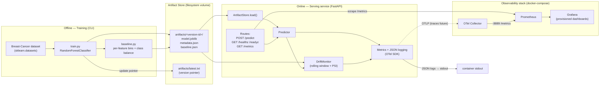
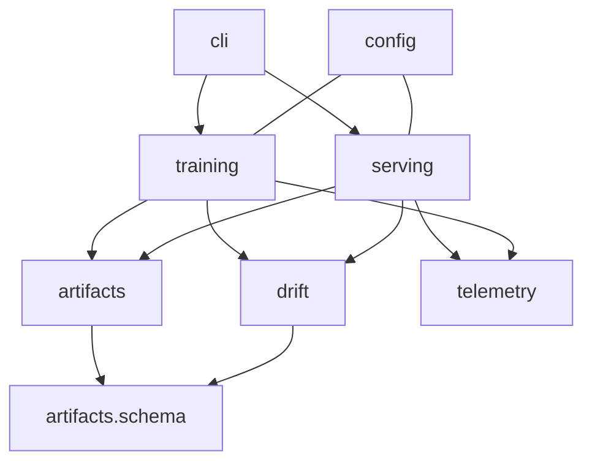
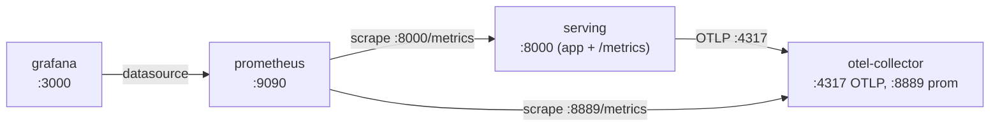

# Design Document Specification — MLOpsPipelineDemo

- **Project:** MLOpsPipelineDemo
- **Stage:** Design (SDLC stage 2)
- **Author:** System Architect
- **Status:** Ready for Python Developer implementation
- **Date:** 2026-09-19
- **Inputs:** `docs/requirements/SRS.md` (FR-1..FR-23, NFR-1..NFR-10, AC-1..AC-14), `docs/status.md` (PM decisions OQ-1..OQ-8, all resolved)
- **Reference pattern:** `CommerceSystemDemo` OpenTelemetry → Prometheus → Grafana observability stack (metric prefix analogue `commerce_` → `mlops_`).

This document is implementation-ready design only: interfaces, contracts, diagrams, and trade-offs. It contains **no implementation code**.

---

## 1. Architecture Overview

### 1.1 Chosen stack (design freeze)

| Concern | Decision | Rationale / trade-off |
|---------|----------|-----------------------|
| Web framework | **FastAPI + Pydantic v2** | PM decision (REST-only), matches `CommerceSystemDemo`; ASGI + auto OpenAPI docs; Pydantic gives schema validation for free (FR-11). Trade-off vs. Flask: async + typed models outweigh the slightly larger dependency. |
| Model serialization | **`joblib`** (scikit-learn recommended) | Native, deterministic for sklearn estimators; avoids `pickle` foot-guns and custom formats. Trade-off vs. ONNX: ONNX adds portability we don't need at demo scale and complicates `predict_proba` parity. |
| Metrics SDK | **OpenTelemetry metrics SDK + Prometheus exporter** | NFR-1 parity with reference. Pull-based `/metrics` on the app (FR-15) is the primary path; OTel Collector runs alongside for pipeline parity and future traces. |
| Config | **`pydantic-settings`** (env-driven) | 12-factor config for `docker-compose`; no code changes to switch artifact version (FR-9). |
| Concurrency | Single-process **async FastAPI**; prediction is CPU-light (30 features, one RF). Drift window guarded by a `threading.Lock`. | No multiprocessing/async pool needed at demo scale (NFR-10). |

### 1.2 Component diagram



### 1.3 Data & control flow (request path)

1. Client `POST /predict` with a feature map.
2. Pydantic validates shape; handler validates keys/order against the loaded artifact feature schema (FR-11).
3. `Predictor.predict()` runs the RF, returns label + `predict_proba` (FR-10).
4. `DriftMonitor.record()` appends the feature vector to the rolling window (FR-19).
5. Metrics recorded (latency histogram, request/predicted-class counters); one structured JSON log line emitted (FR-14).
6. Response includes `model_version` (FR-12).

---

## 2. Package / Module Layout

`src/`-layout package. Distribution name **`mlops-pipeline-demo`**, import package **`mlops_pipeline`**.

```
MLOpsPipelineDemo/
├── pyproject.toml
├── VERSION                        # project semver (distinct from artifact version-id)
├── LICENSE
├── docker-compose.yaml
├── Dockerfile
├── docs/
│   ├── requirements/SRS.md
│   ├── design/DESIGN.md           # this document
│   └── status.md
├── configs/
│   ├── otel-collector-config.yaml
│   ├── prometheus/prometheus.yml
│   └── grafana/
│       └── provisioning/
│           ├── datasources/datasource.yml
│           └── dashboards/
│               ├── dashboards.yml
│               └── mlops-overview.json
├── artifacts/                     # bind-mounted volume (git-ignored except .gitkeep)
├── src/
│   └── mlops_pipeline/
│       ├── __init__.py            # exposes __version__
│       ├── config.py              # Settings (pydantic-settings)
│       ├── cli.py                 # console-script entrypoints
│       ├── training/
│       │   ├── __init__.py
│       │   ├── dataset.py         # load_dataset() → sklearn Bunch wrapper
│       │   ├── baseline.py        # compute_baseline()
│       │   └── train.py           # train() entrypoint
│       ├── artifacts/
│       │   ├── __init__.py
│       │   ├── schema.py          # ArtifactMetadata, FeatureSpec, Baseline (frozen dataclasses)
│       │   ├── versioning.py      # build_version_id(), pointer read/write
│       │   └── store.py           # ArtifactStore (save/load/list/resolve_latest)
│       ├── serving/
│       │   ├── __init__.py
│       │   ├── app.py             # create_app() factory + lifespan
│       │   ├── routes.py          # predict / healthz / readyz handlers
│       │   ├── models.py          # Pydantic request/response models
│       │   ├── predictor.py       # Predictor (wraps loaded estimator)
│       │   └── dependencies.py    # DI providers (get_predictor, get_drift_monitor)
│       ├── drift/
│       │   ├── __init__.py
│       │   ├── psi.py             # compute_psi(), psi_from_proportions()
│       │   └── monitor.py         # DriftMonitor, DriftReport
│       └── telemetry/
│           ├── __init__.py
│           ├── metrics.py         # Metrics instrument definitions + setup_metrics()
│           ├── logging.py         # configure_logging() JSON formatter
│           └── otel.py            # setup_telemetry() wires SDK + Prometheus exporter
└── tests/
    ├── conftest.py                # fixtures: tmp artifact, in-process app, trained model
    ├── training/test_train.py
    ├── artifacts/test_store.py
    ├── drift/test_psi.py
    ├── drift/test_monitor.py
    └── serving/
        ├── test_predict_contract.py
        ├── test_validation.py
        └── test_health.py
```

### 2.1 Module responsibilities & dependency rule

Dependencies point **inward / downward** only; no cycles.



- `artifacts.schema` is the shared, dependency-free contract layer (frozen dataclasses). `training`, `serving`, and `drift` depend on it; it depends on nothing project-internal.
- `serving` never imports `training` (satisfies FR-8: serve without the training code path).
- `telemetry` is a leaf used by `serving`/`training`; it never imports domain modules.

### 2.2 `pyproject.toml`

- **Build backend:** Hatchling (`hatchling.build`) — lightweight, standards-based `src`-layout support. Trade-off vs. Poetry: Hatchling keeps `[project]` PEP 621 canonical with fewer tool-specific keys; adequate since we don't need Poetry's lock/resolver features for a demo.
- **`requires-python = ">=3.11"`** (NFR-5).

Runtime dependencies (pinned with lower+compatible upper bounds in the lockfile / `==` in a constraints file for reproducibility, NFR-3):

| PyPI package | Constraint | Purpose |
|--------------|-----------|---------|
| `fastapi` | `>=0.115,<0.116` | REST app (FR-10..FR-15) |
| `uvicorn[standard]` | `>=0.30,<0.31` | ASGI server |
| `pydantic` | `>=2.7,<3` | request/response models, validation |
| `pydantic-settings` | `>=2.3,<3` | env config (FR-9) |
| `scikit-learn` | `>=1.5,<1.6` | dataset + RandomForest (FR-1..FR-3) |
| `numpy` | `>=1.26,<2.1` | numerics, PSI binning |
| `joblib` | `>=1.4,<2` | model serialization (FR-8) |
| `opentelemetry-sdk` | `>=1.27,<2` | metrics SDK (NFR-1) |
| `opentelemetry-exporter-prometheus` | `>=0.48b0` | `/metrics` exposition (FR-15) |
| `opentelemetry-exporter-otlp-proto-grpc` | `>=1.27,<2` | OTLP → Collector (parity/future traces) |
| `prometheus-client` | `>=0.20,<1` | Prometheus registry backing the exporter |
| `python-json-logger` | `>=2.0,<3` | structured JSON logs (FR-14) |

Dev/test optional group `[project.optional-dependencies].dev`: `pytest>=8`, `pytest-cov`, `httpx` (FastAPI `TestClient`), `ruff`, `mypy`.

Console scripts (`[project.scripts]`):

```toml
[project.scripts]
mlops-train = "mlops_pipeline.cli:train_command"
mlops-serve = "mlops_pipeline.cli:serve_command"
```

- `mlops-train` → runs training, writes artifact + updates `latest` pointer.
- `mlops-serve` → launches uvicorn against `create_app()` (thin wrapper; docker `CMD` may call uvicorn directly).

Test discovery: `tests/` mirrors `src/mlops_pipeline/`; `pytest` config under `[tool.pytest.ini_options]` with `pythonpath = ["src"]` and `testpaths = ["tests"]`.

---

## 3. Artifact Format & Versioning

### 3.1 On-disk layout

```
artifacts/
├── latest.txt                     # single line: the current version-id
├── 20260919T141530Z-a1b2c3d4/
│   ├── model.joblib               # joblib.dump(estimator)
│   ├── metadata.json              # ArtifactMetadata (see 3.3)
│   └── baseline.json              # Baseline (see 3.4)
└── 20260919T151002Z-9f8e7d6c/
    └── ...
```

An artifact directory is **immutable** once written (FR-4): the developer writes to a temp dir and atomically renames into place; a version-id collision aborts rather than overwrites.

### 3.2 Version-id scheme (FR-4, OQ-4)

`<UTC-timestamp>-<short-content-hash>`:

- `UTC-timestamp`: `strftime("%Y%m%dT%H%M%SZ")` (compact ISO-8601 basic, sortable).
- `short-content-hash`: first **8 hex chars** of `sha256(model.joblib bytes)`.

Example: `20260919T141530Z-a1b2c3d4`. Timestamp guarantees uniqueness/ordering; content hash ties the id to the exact serialized model (reproducibility signal for FR-7). This is **distinct from the project `VERSION` semver** used by the release stage.

### 3.3 `metadata.json` schema (FR-5)

```jsonc
{
  "schema_version": 1,
  "version_id": "20260919T141530Z-a1b2c3d4",
  "created_at": "2026-09-19T14:15:30Z",     // UTC ISO-8601
  "dataset_name": "breast_cancer",
  "model_type": "sklearn.ensemble.RandomForestClassifier",
  "random_seed": 42,
  "library_versions": {
    "python": "3.11.9",
    "scikit-learn": "1.5.1",
    "numpy": "2.0.1",
    "joblib": "1.4.2"
  },
  "hyperparameters": { "n_estimators": 200, "max_depth": null },
  "metrics": {
    "accuracy": 0.9649,
    "f1": 0.9722,
    "precision": 0.9605,
    "recall": 0.9844
  },
  "target_classes": ["malignant", "benign"],   // index order == model.classes_
  "feature_schema": [
    { "name": "mean radius", "dtype": "float64", "min": 6.981, "max": 28.11 },
    { "name": "mean texture", "dtype": "float64", "min": 9.71, "max": 39.28 }
    // ... 30 entries, ordered as the model expects
  ],
  "model_file": "model.joblib",
  "model_sha256": "a1b2c3d4e5f6..."          // full digest; version-id embeds first 8
}
```

### 3.4 `baseline.json` schema (FR-6)

Per-feature histogram captured at training time, sufficient for PSI without storing raw data (NFR: no long-term per-record persistence).

```jsonc
{
  "schema_version": 1,
  "version_id": "20260919T141530Z-a1b2c3d4",
  "n_samples": 455,                            // training split size
  "class_balance": { "malignant": 0.373, "benign": 0.627 },
  "features": [
    {
      "name": "mean radius",
      "bin_edges": [6.98, 8.2, 9.9, /* ... */ 28.11],   // 10 quantile bins → 11 edges
      "bin_proportions": [0.10, 0.10, /* ... */ 0.10],  // sums to 1.0; expected distribution
      "min": 6.981,
      "max": 28.11,
      "mean": 14.12,
      "std": 3.52
    }
    // ... one entry per feature, same order as feature_schema
  ]
}
```

Binning: **decile (quantile) bins** on the training feature (default 10 bins). Edges are stored so the live side buckets identically. This is the "expected" distribution in the PSI formula.

### 3.5 `latest` pointer mechanism (FR-9)

A plain-text file `artifacts/latest.txt` containing exactly the current version-id. Chosen over a **symlink** for cross-platform / docker-bind-mount robustness (symlinks behave inconsistently across mounted volumes). Written atomically (temp file + rename) at the end of a successful training run. `ArtifactStore.resolve_latest()` reads it; a missing/empty file means "no artifact" → readiness fails (NFR-8).

---

## 4. Key Interfaces

All signatures are type-hinted stubs (design contract). Bodies are the developer's job.

### 4.1 Shared schema — `artifacts/schema.py`

```python
from dataclasses import dataclass

@dataclass(frozen=True, slots=True)
class FeatureSpec:
    name: str
    dtype: str
    min: float
    max: float

@dataclass(frozen=True, slots=True)
class ArtifactMetadata:
    schema_version: int
    version_id: str
    created_at: str
    dataset_name: str
    model_type: str
    random_seed: int
    library_versions: dict[str, str]
    hyperparameters: dict[str, object]
    metrics: dict[str, float]
    target_classes: list[str]
    feature_schema: list[FeatureSpec]
    model_file: str
    model_sha256: str

    @property
    def feature_names(self) -> list[str]: ...           # ordered names

    def to_json(self) -> dict[str, object]: ...
    @classmethod
    def from_json(cls, data: dict[str, object]) -> "ArtifactMetadata": ...

@dataclass(frozen=True, slots=True)
class FeatureBaseline:
    name: str
    bin_edges: list[float]
    bin_proportions: list[float]
    min: float
    max: float
    mean: float
    std: float

@dataclass(frozen=True, slots=True)
class Baseline:
    schema_version: int
    version_id: str
    n_samples: int
    class_balance: dict[str, float]
    features: list[FeatureBaseline]

    def to_json(self) -> dict[str, object]: ...
    @classmethod
    def from_json(cls, data: dict[str, object]) -> "Baseline": ...
```

Immutable value types (`frozen=True`) because metadata/baseline must not mutate after load — clear ownership, safe to share across the async app.

### 4.2 Training — `training/train.py`, `training/dataset.py`, `training/baseline.py`

```python
from dataclasses import dataclass
from pathlib import Path

@dataclass(frozen=True, slots=True)
class TrainConfig:
    dataset: str = "breast_cancer"
    seed: int = 42
    test_size: float = 0.2
    n_estimators: int = 200
    n_bins: int = 10
    artifacts_dir: Path = Path("artifacts")

@dataclass(frozen=True, slots=True)
class TrainResult:
    version_id: str
    artifact_dir: Path
    metrics: dict[str, float]

def train(config: TrainConfig) -> TrainResult: ...       # FR-1..FR-7 orchestrator

# dataset.py
@dataclass(frozen=True, slots=True)
class LoadedDataset:
    X_train: "np.ndarray"
    X_test: "np.ndarray"
    y_train: "np.ndarray"
    y_test: "np.ndarray"
    feature_names: list[str]
    target_names: list[str]

def load_dataset(name: str, *, seed: int, test_size: float) -> LoadedDataset: ...

# baseline.py
def compute_baseline(
    X_train: "np.ndarray",
    y_train: "np.ndarray",
    feature_names: list[str],
    target_names: list[str],
    version_id: str,
    *, n_bins: int = 10,
) -> Baseline: ...                                        # FR-6
```

### 4.3 Artifact store — `artifacts/store.py`, `artifacts/versioning.py`

```python
from dataclasses import dataclass
from pathlib import Path
from sklearn.base import BaseEstimator

# versioning.py
def build_version_id(model_bytes: bytes, *, created_at: str) -> str: ...   # FR-4
def read_pointer(root: Path) -> str | None: ...
def write_pointer(root: Path, version_id: str) -> None: ...                 # atomic

# store.py
@dataclass(frozen=True, slots=True)
class LoadedArtifact:
    model: BaseEstimator
    metadata: ArtifactMetadata
    baseline: Baseline

class ArtifactStore:
    def __init__(self, root: Path) -> None: ...

    def save(
        self, model: BaseEstimator, metadata: ArtifactMetadata, baseline: Baseline
    ) -> str: ...                                        # returns version_id; FR-4/FR-8, atomic, no overwrite

    def load(self, version_id: str | None = None) -> LoadedArtifact: ...    # None → latest; FR-9
    def resolve_latest(self) -> str | None: ...
    def list_versions(self) -> list[str]: ...            # sorted newest-first

class ArtifactNotFoundError(RuntimeError): ...
```

### 4.4 Drift / PSI — `drift/psi.py`, `drift/monitor.py`

```python
from collections.abc import Mapping, Sequence
from dataclasses import dataclass

# psi.py — pure functions, no I/O, fully unit-testable (AC-13)
def bucket_proportions(values: Sequence[float], bin_edges: Sequence[float]) -> list[float]: ...
def psi_from_proportions(
    expected: Sequence[float], actual: Sequence[float], *, eps: float = 1e-6
) -> float: ...                                          # sum((a-e) * ln(a/e))

DRIFT_NONE = "none"          # PSI < 0.1
DRIFT_MODERATE = "moderate"  # 0.1 <= PSI < 0.25
DRIFT_SIGNIFICANT = "significant"  # PSI >= 0.25

def classify_psi(psi: float) -> str: ...

# monitor.py
@dataclass(frozen=True, slots=True)
class DriftReport:
    per_feature: dict[str, float]     # feature name → PSI
    aggregate: float                  # mean PSI across features
    status: str                       # classify_psi(aggregate)
    n_samples: int                    # window fill at compute time

class DriftMonitor:
    def __init__(self, baseline: Baseline, *, window_size: int = 500, min_samples: int = 100) -> None: ...
    def record(self, features: Mapping[str, float]) -> None: ...   # thread-safe append; FR-19
    def compute(self) -> DriftReport: ...                          # returns zeros/status "none" until min_samples reached
    @property
    def sample_count(self) -> int: ...
```

The rolling window is a per-feature `collections.deque(maxlen=window_size)` set (or one deque of vectors) guarded by a `threading.Lock`. `compute()` re-buckets the current window against the baseline `bin_edges` and computes PSI per feature; `aggregate` = arithmetic mean. Below `min_samples` it returns a `none` report so a cold service doesn't emit noise.

### 4.5 Telemetry — `telemetry/metrics.py`, `telemetry/otel.py`, `telemetry/logging.py`

```python
from dataclasses import dataclass
from fastapi import FastAPI

@dataclass
class Metrics:
    request_counter: "Counter"            # mlops_prediction_requests_total
    error_counter: "Counter"              # mlops_prediction_errors_total
    latency_hist: "Histogram"             # mlops_inference_latency_seconds
    predicted_class_counter: "Counter"    # mlops_predicted_class_total
    drift_gauge: "ObservableGauge|Gauge"  # mlops_feature_drift_psi
    drift_aggregate_gauge: "Gauge"        # mlops_drift_psi_aggregate
    model_ready_gauge: "Gauge"            # mlops_model_ready
    model_info_gauge: "Gauge"            # mlops_model_info

def setup_metrics(meter_provider) -> Metrics: ...        # instrument creation, mlops_ prefix

def setup_telemetry(app: FastAPI, settings: "Settings") -> Metrics:
    """Wire OTel MeterProvider + Prometheus reader, mount /metrics, return Metrics."""
    ...

# logging.py
def configure_logging(level: str = "INFO") -> None: ...  # JSON formatter → stdout; FR-14
def log_prediction(*, request_id: str, endpoint: str, status: int,
                   latency_ms: float, model_version: str) -> None: ...
```

### 4.6 Serving models — `serving/models.py` (Pydantic v2)

```python
from pydantic import BaseModel, Field

class PredictRequest(BaseModel):
    # Keyed by feature name so the contract is order-independent and self-describing.
    features: dict[str, float] = Field(..., description="30 named breast-cancer features")

class PredictResponse(BaseModel):
    request_id: str
    model_version: str
    predicted_class: str
    predicted_index: int
    probabilities: dict[str, float] | None = None   # class name → probability; FR-10

class HealthResponse(BaseModel):
    status: str                                      # "ok"

class ReadyResponse(BaseModel):
    ready: bool
    model_version: str | None = None                 # FR-12/FR-13
    reason: str | None = None
```

**Batch-extensibility (OQ-7):** single-record uses `POST /predict` with `PredictRequest`. Batch is added later as `POST /predict:batch` accepting `{"records": [ {features...}, ... ]}` → `list[PredictResponse]`, leaving the single-record contract untouched.

### 4.7 Route handlers — `serving/routes.py`, `serving/app.py`

```python
from fastapi import FastAPI, Depends

def create_app(settings: "Settings | None" = None) -> FastAPI:
    """App factory. Lifespan loads the artifact (via ArtifactStore) into app state,
    builds Predictor + DriftMonitor, and calls setup_telemetry(). Readiness flips
    true only after a valid artifact is loaded (NFR-8)."""
    ...

async def predict(
    request: PredictRequest,
    predictor: "Predictor" = Depends(get_predictor),
    monitor: "DriftMonitor" = Depends(get_drift_monitor),
    metrics: "Metrics" = Depends(get_metrics),
) -> PredictResponse: ...          # FR-10/11/12/14/16/17/18

async def healthz() -> HealthResponse: ...           # liveness only; FR-13
async def readyz(app_state = Depends(get_app_state)) -> ReadyResponse: ...  # FR-13/NFR-8
# GET /metrics is mounted by setup_telemetry (Prometheus exposition); FR-15
```

### 4.8 Predictor — `serving/predictor.py`

```python
from collections.abc import Mapping

class Predictor:
    def __init__(self, artifact: LoadedArtifact) -> None: ...

    @property
    def model_version(self) -> str: ...

    def validate(self, features: Mapping[str, float]) -> "np.ndarray":
        """Check all schema feature names present, no extras, numeric.
        Raise FeatureValidationError (→ HTTP 422) otherwise. Returns ordered vector. FR-11"""
        ...

    def predict(self, features: Mapping[str, float]) -> "PredictionOutcome": ...  # label + proba

class FeatureValidationError(ValueError): ...   # mapped to 422 via exception handler
```

### 4.9 Endpoint contracts summary

| Method / path | Request | Success | Error |
|---------------|---------|---------|-------|
| `POST /predict` | `PredictRequest` | `200` `PredictResponse` | `422` on schema/validation failure (FR-11) |
| `GET /healthz` | — | `200` `{"status":"ok"}` | — (always live) |
| `GET /readyz` | — | `200` `{"ready":true,"model_version":...}` | `503` `{"ready":false,"reason":...}` when no artifact (NFR-8) |
| `GET /metrics` | — | `200` Prometheus text (`mlops_*`) | — |

---

## 5. Metrics Catalog

All names carry the **`mlops_`** prefix (NFR-1). OTel + Prometheus exporter renders histograms with `_bucket/_sum/_count` and appends `_total` to counters automatically.

| Metric | Type | Labels | Satisfies | Notes |
|--------|------|--------|-----------|-------|
| `mlops_prediction_requests_total` | Counter | `endpoint`, `status_code`, `model_version` | FR-17 | throughput + status breakdown |
| `mlops_prediction_errors_total` | Counter | `endpoint`, `error_type` | FR-17 | drives error-rate panel (validation vs. internal) |
| `mlops_inference_latency_seconds` | Histogram | `endpoint`, `model_version` | FR-16, NFR-2 | buckets tuned for sub-200 ms (e.g. 1,2,5,10,25,50,100,200,500 ms) → p50/p95/p99 |
| `mlops_predicted_class_total` | Counter | `predicted_class`, `model_version` | FR-18 | predicted-class distribution |
| `mlops_feature_drift_psi` | Gauge | `feature`, `model_version` | FR-20 | per-feature PSI, refreshed on compute |
| `mlops_drift_psi_aggregate` | Gauge | `model_version` | FR-20 | mean PSI across features |
| `mlops_model_ready` | Gauge | `model_version` | FR-13, NFR-8 | 1 ready / 0 not ready |
| `mlops_model_info` | Gauge | `model_version`, `dataset` | FR-12 | constant `1` info-style metric |

Drift gauges are updated by a periodic refresh (see §6.3), not on every request, to bound cost.

---

## 6. Drift Design (PSI)

### 6.1 Rolling window (FR-19, A-8)

- In-memory only; no persistence. One bounded structure holding the last `window_size` (default **500**) live feature vectors, or per-feature deques.
- Appended on every successful prediction via `DriftMonitor.record()`.
- Guarded by a `threading.Lock` (uvicorn may serve requests on a threadpool for sync paths; lock keeps window consistent).
- Cold-start guard: no PSI reported until `min_samples` (default **100**) collected.

### 6.2 PSI computation

For each feature, using the baseline `bin_edges` (expected proportions `E_i`, i.e. training deciles ≈ 0.1 each) and live `A_i` (window proportions in the same bins):

$$\mathrm{PSI} = \sum_{i=1}^{k} (A_i - E_i)\,\ln\!\frac{A_i}{E_i}$$

with an $\varepsilon$ floor on empty bins to avoid `log(0)`. Aggregate score = mean of per-feature PSI. Interpretation thresholds:

| PSI (aggregate) | Status | Meaning |
|-----------------|--------|---------|
| `< 0.10` | `none` | no significant drift |
| `0.10 – 0.25` | `moderate` | investigate |
| `>= 0.25` | `significant` | likely drift |

### 6.3 Exposure (FR-20)

- **Metrics:** on a refresh tick (background `asyncio` task on an interval, default 15 s, or lazily every N requests) `DriftMonitor.compute()` runs and updates `mlops_feature_drift_psi{feature=...}` and `mlops_drift_psi_aggregate`.
- **Logs:** when status transitions to `moderate`/`significant`, emit one structured JSON log event (`event="drift_detected"`, `aggregate_psi`, `status`, `model_version`) — no alerting rules this iteration (OQ-8).
- **Dashboard:** Grafana panel visualizes the aggregate gauge + top drifting features (FR-22).

---

## 7. Observability Wiring

### 7.1 Metrics path (primary — pull)

OTel `MeterProvider` is configured with a `PrometheusMetricReader`; `setup_telemetry()` mounts the exporter's ASGI/`prometheus_client` registry at **`GET /metrics`** on the FastAPI app (FR-15). Prometheus scrapes the service directly. This is the authoritative path for all `mlops_*` metrics.

### 7.2 OTel Collector role

The Collector runs in compose for **reference parity** and to host the future OTLP trace pipeline (Tempo deferred, OQ-6). In this iteration the app may additionally push OTLP metrics to the Collector, which re-exposes them on `:8889/metrics`; Prometheus scrapes both targets. Traces/Loki are explicitly **out of scope** now but the Collector config leaves the receiver in place so they can be enabled later without restructuring.

### 7.3 docker-compose services (NFR-4, AC-12)



| Service | Image / build | Key config file |
|---------|---------------|-----------------|
| `serving` | build `Dockerfile`, mounts `./artifacts` | env: `MLOPS_ARTIFACT_VERSION`, `MLOPS_ARTIFACTS_DIR` |
| `otel-collector` | `otel/opentelemetry-collector-contrib` | `configs/otel-collector-config.yaml` |
| `prometheus` | `prom/prometheus` | `configs/prometheus/prometheus.yml` |
| `grafana` | `grafana/grafana` | `configs/grafana/provisioning/**` |

`serving`'s compose healthcheck hits `/readyz` so Grafana/Prometheus start ordering is sane and traffic is gated on readiness (NFR-8).

### 7.4 Grafana provisioning-as-code (FR-23, AC-11)

- Datasource: `configs/grafana/provisioning/datasources/datasource.yml` → Prometheus at `http://prometheus:9090`.
- Dashboard provider: `configs/grafana/provisioning/dashboards/dashboards.yml` points at the dashboards folder.
- Dashboard JSON: `configs/grafana/provisioning/dashboards/mlops-overview.json` with panels: **p95 latency** (from `mlops_inference_latency_seconds`), **error rate** (from `mlops_prediction_errors_total` / `mlops_prediction_requests_total`), **predicted-class distribution** (`mlops_predicted_class_total`), **PSI aggregate + per-feature** (`mlops_drift_psi_aggregate`, `mlops_feature_drift_psi`). Mirrors the `CommerceSystemDemo` provisioning tree.

### 7.5 Structured logging (FR-14)

`configure_logging()` installs a JSON formatter on the root logger → stdout (captured by docker). Per-prediction record fields: `timestamp`, `request_id`, `endpoint`, `status`, `latency_ms`, `model_version`, plus reserved trace-correlation keys (`trace_id`, `span_id`) populated when tracing is enabled later.

---

## 8. Test Strategy Outline (NFR-7, AC-13)

All tests run **without** the docker stack (in-process app + tmp artifact fixtures). Structure mirrors `src/`.

| Area | Test focus | Key assertions | AC / FR |
|------|-----------|----------------|---------|
| Training → artifact | `train()` on tiny config writes dir with `model.joblib`, `metadata.json`, `baseline.json` | files exist; metadata has all FR-5 fields; feature_schema length == 30 | AC-1, FR-1..FR-6 |
| Reproducibility | two `train()` runs, same seed | metrics equal within tolerance; two runs → two distinct version-ids, neither overwritten | AC-2, FR-7 |
| Baseline | `compute_baseline()` | proportions sum ≈ 1.0 per feature; class_balance sums to 1.0; edges monotonic | AC-3, FR-6 |
| Artifact store | `save`/`load`/`resolve_latest`/`list_versions` | round-trip equality; `latest.txt` updated; `load(None)` == latest; missing id raises `ArtifactNotFoundError` | AC-4, FR-8/FR-9 |
| PSI math | `psi_from_proportions`, `bucket_proportions`, `classify_psi` | identical dists → PSI ≈ 0; shifted dist → PSI in `moderate`/`significant`; eps handles empty bins | AC-10, FR-19 |
| Drift monitor | `record` + `compute` | below `min_samples` → status `none`; after synthetic shift → aggregate rises; window bounded at `window_size` | AC-10, FR-19/FR-20 |
| Predict contract | `TestClient POST /predict` valid payload | 200; response has `predicted_class`, `probabilities`, `model_version` | AC-5, FR-10/FR-12 |
| Validation | missing/extra/non-numeric feature | 422 with descriptive message | AC-6, FR-11 |
| Health/readiness | `/healthz` always 200; `/readyz` 503 when no artifact, 200 once loaded | ready gating correct; `model_version` surfaced | AC-7, FR-13/NFR-8 |
| Metrics surface | `GET /metrics` after a prediction | body contains `mlops_inference_latency_seconds`, `mlops_prediction_requests_total`, `mlops_predicted_class_total` | AC-9, FR-15..FR-18 |
| Logging | capture stdout on a prediction | one JSON record with required fields | AC-8, FR-14 |

Load/latency check (AC-14, NFR-2) is a documented manual/optional step (e.g. simple `hey`/`locust` run against the running container) — not part of the unit suite, but noted for QA.

Fixtures (`conftest.py`): `tmp_artifacts_dir`, `trained_artifact` (small `n_estimators` for speed), `client` (app built against the tmp artifact).

---

## 9. Traceability

### 9.1 Functional requirements → design

| FR | Design element |
|----|----------------|
| FR-1 | `training/dataset.py::load_dataset` (breast_cancer) |
| FR-2 | `training/train.py` RandomForest + `TrainConfig.seed` |
| FR-3 | `train()` computes accuracy/f1/precision/recall → `metadata.metrics` |
| FR-4 | `versioning.build_version_id` + immutable artifact dir; `ArtifactStore.save` no-overwrite |
| FR-5 | `ArtifactMetadata` / `metadata.json` (§3.3) |
| FR-6 | `baseline.compute_baseline` / `baseline.json` (§3.4) |
| FR-7 | fixed seed + pinned deps (NFR-3); reproducibility test |
| FR-8 | `joblib` serialization; `serving` loads without `training` imports |
| FR-9 | `ArtifactStore.load(version_id=None→latest)`; `latest.txt`; `MLOPS_ARTIFACT_VERSION` env |
| FR-10 | `POST /predict`, `Predictor.predict` with `predict_proba` |
| FR-11 | `Predictor.validate` → `FeatureValidationError` → 422 |
| FR-12 | `PredictResponse.model_version`, `mlops_model_info` |
| FR-13 | `/healthz`, `/readyz`, `mlops_model_ready` |
| FR-14 | `telemetry/logging.py` JSON per-request log |
| FR-15 | `/metrics` via OTel Prometheus exporter |
| FR-16 | `mlops_inference_latency_seconds` histogram |
| FR-17 | `mlops_prediction_requests_total`, `mlops_prediction_errors_total` |
| FR-18 | `mlops_predicted_class_total` |
| FR-19 | `DriftMonitor` + `psi.py` |
| FR-20 | `mlops_feature_drift_psi`, `mlops_drift_psi_aggregate` + drift log event |
| FR-21 | Grafana `mlops-overview.json` latency/error panels |
| FR-22 | Grafana drift/predicted-class panels |
| FR-23 | `configs/grafana/provisioning/**` as code |

### 9.2 NFR coverage

| NFR | Design element |
|-----|----------------|
| NFR-1 | OTel + Prometheus, `mlops_` prefix, JSON logs |
| NFR-2 | latency histogram buckets < 200 ms; documented in AC-14 step |
| NFR-3 | fixed seed + pinned deps / constraints file |
| NFR-4 | `docker-compose.yaml`, no cloud services |
| NFR-5 | `requires-python = ">=3.11"` |
| NFR-6 | `training`/`artifacts`/`serving`/`telemetry`/`drift` separation |
| NFR-7 | §8 pytest suite, no docker |
| NFR-8 | `/readyz` gates on loaded artifact; compose healthcheck |
| NFR-9 | existing `LICENSE`, permissive deps, public dataset |
| NFR-10 | toy dataset, single RF, no GPU |

### 9.3 Acceptance criteria — architectural support

| AC | Supported by |
|----|--------------|
| AC-1 | §3 artifact layout + `train()` |
| AC-2 | version-id scheme + reproducibility test |
| AC-3 | `baseline.json` |
| AC-4 | `ArtifactStore.load` + `PredictResponse.model_version` + `/readyz` |
| AC-5 | `POST /predict` contract |
| AC-6 | `Predictor.validate` → 422 |
| AC-7 | `/readyz` gating |
| AC-8 | JSON prediction log |
| AC-9 | `/metrics` catalog §5 |
| AC-10 | PSI drift metric + log |
| AC-11 | Grafana provisioning §7.4 |
| AC-12 | `docker-compose` §7.3 |
| AC-13 | §8 test suite |
| AC-14 | latency histogram + documented load-test step |

All AC-1..AC-14 are architecturally supported.

---

## 10. Design Decisions, Trade-offs & Risks

### 10.1 Key decisions

1. **`latest.txt` pointer over symlink** — portability across docker bind mounts; trade-off: must handle atomic write manually.
2. **Feature map (`dict[str,float]`) request over positional list** — self-describing, order-independent, clearer 422s; trade-off: slightly larger payloads than a bare array (irrelevant at 30 features).
3. **Baseline stores histograms, not raw data** — bounded artifact size, aligns with "no long-term per-record storage"; trade-off: PSI bin edges fixed at training time (acceptable, standard PSI practice).
4. **Pull-based `/metrics` primary, Collector for parity/future traces** — satisfies FR-15 directly while honoring the "Collector required" decision without over-building a push pipeline now.
5. **Hatchling build backend** — minimal PEP 621 config; trade-off vs. Poetry: no built-in lock; use a `constraints.txt`/lockfile for NFR-3.

### 10.2 Risks & assumptions for the PM

- **R-1 (assumption):** OTel Prometheus exporter + `prometheus_client` versions must be compatible; the pinned versions in §2.2 are indicative and should be reconciled against the actual `CommerceSystemDemo` pins during implementation to guarantee parity.
- **R-2:** PSI over a 500-record window on 30 features is cheap, but the refresh cadence (interval vs. per-N-requests) affects gauge freshness vs. CPU. Default 15 s interval assumed; tune if load tests show noise.
- **R-3:** `predict_proba` class ordering must match `metadata.target_classes` (i.e. `model.classes_`); a mismatch would mislabel probabilities. Flagged as a must-test invariant (covered by the predict-contract test).
- **R-4:** No scope change detected against the SRS — no missing requirement to escalate to the Requirements Analyst. Batch prediction (OQ-7) is intentionally left as a non-breaking future addition, not implemented.
- **R-5 (assumption):** `sklearn` version pin affects reproducibility tolerance (FR-7); the "documented tolerance" for AC-2 should be set once the developer observes real metric variance (recommend exact-equal for a fixed seed + fixed sklearn, else a small `atol`).

---

**Design is ready for the Python Developer agent to implement.**
```